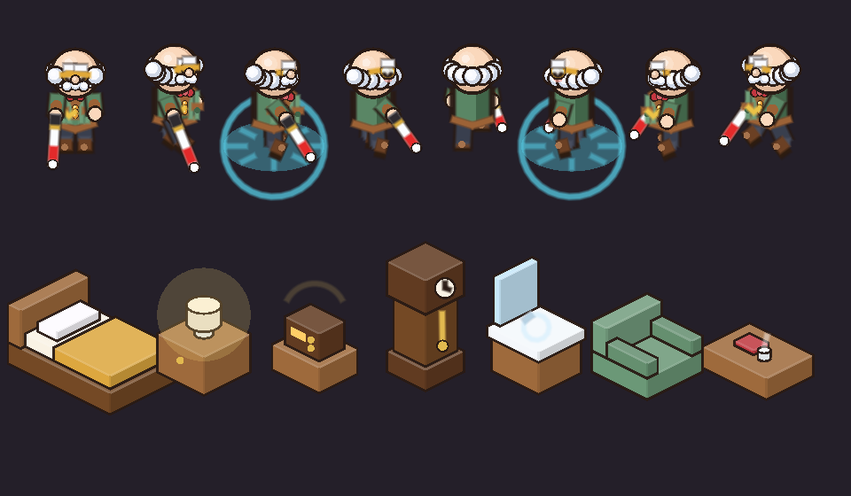
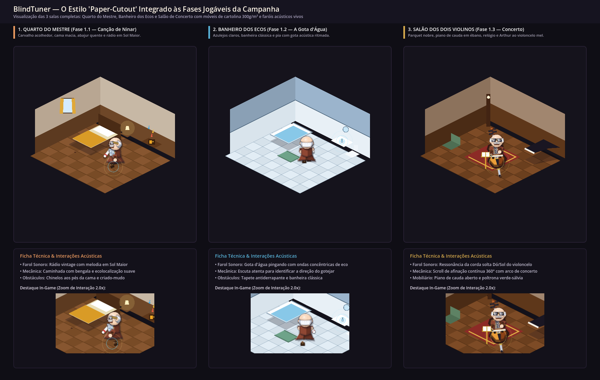
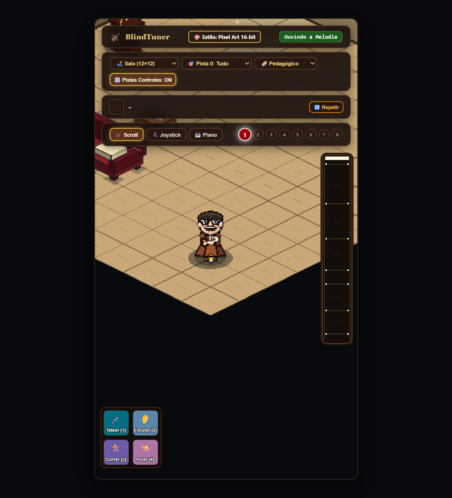
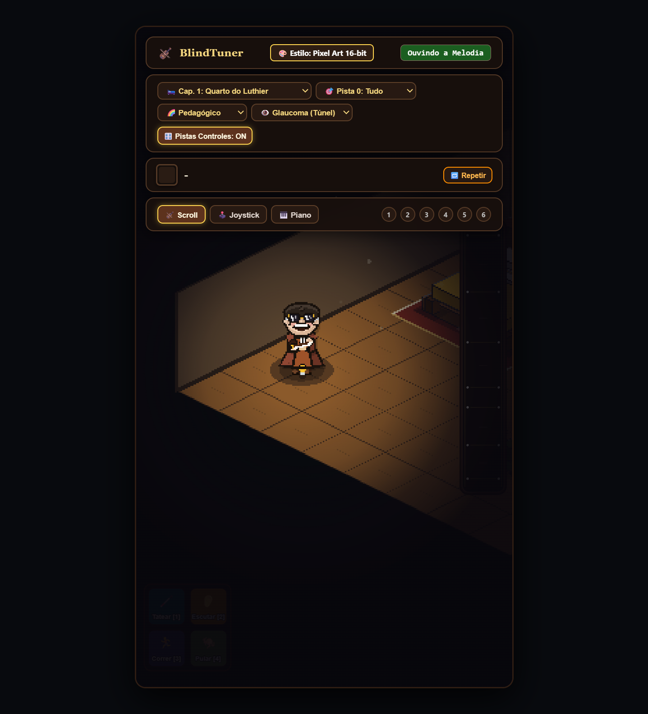

<p align="center">
  
</p>

<h1 align="center">BlindTuner</h1>

<p align="center">
  <em>Um jogo musical e de acessibilidade que inverte a lógica da afinação: descubra notas, frequências e caminhos através do som, cores inclusivas e ecolocalização.</em>
</p>

<p align="center">
  <a href="https://jdaniloc.github.io/BlindTuner/"></a>
  
  
  
</p>

---

## 🎮 Jogue Agora no Navegador

A versão Web do BlindTuner está publicada e jogável diretamente pelo navegador:

👉 **[https://jdaniloc.github.io/BlindTuner/](https://jdaniloc.github.io/BlindTuner/)**

---

## 💡 Sobre o Projeto

Normalmente afinamos nossos instrumentos para tocar música usando afinadores eletrônicos ou aplicativos. **E se invertêssemos essa ordem?**

No **BlindTuner**, você acompanha a rotina do **Sr. Arthur**, um violoncelista idoso com baixa visão, navegando por sua casa através de estímulos sonoros, afinação contínua de cordas e pistas visuais de alto contraste. O jogador precisa reconhecer alturas, navegar por ângulos sonoros de 360° e desviar de obstáculos diários guiando-se pela escuta e pela bengala tátil.

---

## 🖼️ Versão Godot 4

O projeto ativo em `godot/` reimagina a experiência como um jogo isométrico 2.5D com renderização em pixel art detalhada, simulação de física acústica e suíte com mais de 500 testes automatizados.

### Gameplay e Sistema de Notas (Godot 4)
<p align="center">
  
</p>

- **Controle de 12 Semitons / 360°**: Mapeamento harmônico onde cada semitom aponta em uma direção do espaço isométrico.
- **Áudio Sintético PCM**: Síntese procedural sem estalos, envoltória contínua e microtons.
- **Acessibilidade e Contraste**: Motor de cálculo de distância de cor que garante conformidade WCAG AAA em todos os esquemas cromáticos (Clássico, Pedagógico e Alto Contraste).

### Cômodos e Level Design
<p align="center">
  
</p>

---

## 🌐 Versão Web Interativa (TypeScript + PixiJS v8)

Para máxima acessibilidade e compatibilidade em qualquer dispositivo sem necessidade de download, desenvolvemos a versão Web em `poc-web/`:

<p align="center">
  
</p>

### Funcionalidades da Versão Web:
- **Modos de Entrada Versáteis**:
  - *Piano de Notas*: toque direto com mapeamento de teclado e semitons.
  - *Scroll Fretless 360°*: arraste contínuo simulando o espelho de um violoncelo com feedback tátil e vibração visual da corda.
  - *Joystick Isométrico*: navegação analógica integrada.
- **Simulador de Baixa Visão**: Simulação em tempo real via shaders de **Glaucoma** (visão tubular periférica), **Catarata** (perda de contraste e desfoque) e **Fotofobia**.
- **Ações Especiais com a Bengala**: Sonda tátil que dispara pulsos de ecolocalização com contornos iluminados para identificação de móveis e obstáculos.
- **Progressão de Fases**: Quarto, Banheiro e Sala de Estar com avaliação por estrelas e tempo limite.

<p align="center">
  
</p>

---

## 🚀 Como Executar

### 1. Versão Web (`poc-web/`)
Requer Node.js 20+:

```bash
cd poc-web
npm install
npm run dev
```

Para rodar os testes automatizados da versão Web:
```bash
npm test
```

### 2. Versão Godot (`godot/`)
Requer Godot 4.3+:

```bash
# Abrir no editor
godot --path godot

# Executar a suíte de testes GUT via linha de comando
godot --headless --path godot -s "res://addons/gut/gut_cmdln.gd" -gdir="res://tests" -gexit
```

---

## 🏛️ Versão Legada (`blindturner/`)

O protótipo original mobile desenvolvido em React Native + Expo encontra-se preservado na pasta `blindturner/` como registro histórico do projeto.

<p align="center">
  
</p>

---

## 👥 Equipe e Créditos

Desenvolvido com carinho por:
- [José Danilo](http://github.com/jdaniloc)
- [Sofia Melo](https://github.com/Sofiamdl)
- [Caio Barreto](https://github.com/CaiolBarreto)
- [Pedro Queiroz](https://github.com/pccql)
- [Alex Damascena](https://github.com/apfdamascena)
- [Marcos André](https://github.com/MarcosND)
