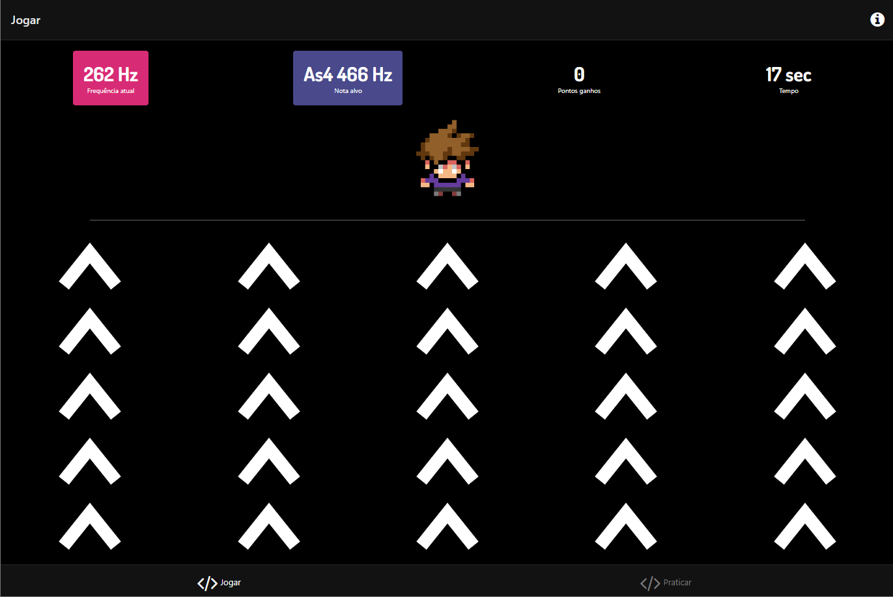
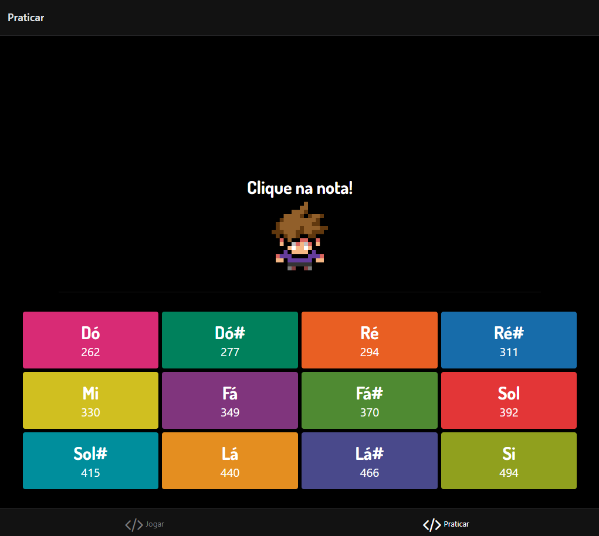

<p align="center">
  
</p>

> A music game that through colors, patterns and a beautiful history
> wants to help you to practice music tunning.

## Motivation

Usually we need to tune our instruments to play music, and we use a physical tuner or an app to do that. What if we reversed that order? What if we had to indicate what frequency for a particular note? It's with this premise and a simple story and gameplay that we created **BlindTuner**.

## Status

O BlindTuner está sendo reimaginado como um jogo isométrico em pixel art (Godot 4). O projeto ativo é `godot/` — o React Native antigo em `blindturner/` permanece congelado como referência histórica.

## Stack atual

- [Godot 4](https://godotengine.org/) — engine 2D, editor visual, export web e mobile.
- GDScript — linguagem de scripting do Godot.
- [GUT](https://github.com/bitwes/Gut) — framework de testes unitários.

## Getting Started

Instale o Godot 4.3 ou superior. Abra o projeto:

```bash
godot --path godot
```

Rodar os testes:

```bash
godot --headless --path godot -s "res://addons/gut/gut_cmdln.gd" -gdir="res://tests" -gexit
```

## Stack legada (`blindturner/`)

O código React Native + Expo original está preservado em `blindturner/` para consulta. Instruções de execução originais ficam no commit anterior ao reimagining.

<p align="center">
  
</p>

---

A project made by:
- [José Danilo](http://github.com/jdaniloc)
- [Sofia Melo](https://github.com/Sofiamdl)
- [Caio Barreto](https://github.com/CaiolBarreto)
- [Pedro Queiroz](https://github.com/pccql)
- [Alex Damascena](https://github.com/apfdamascena)
- [Marcos André](https://github.com/MarcosND)
